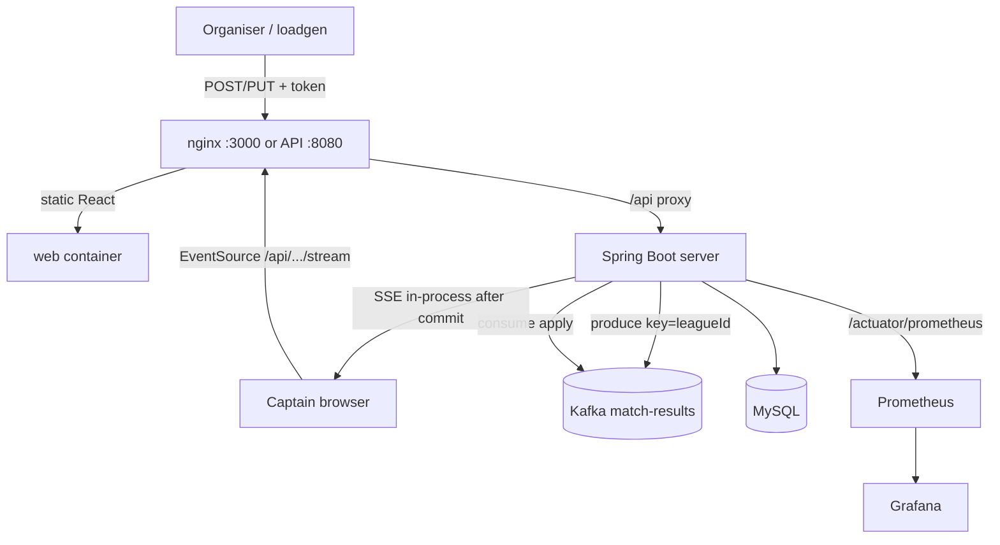
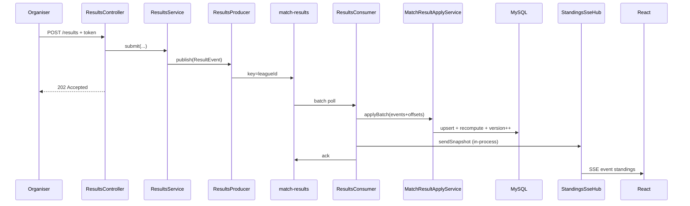
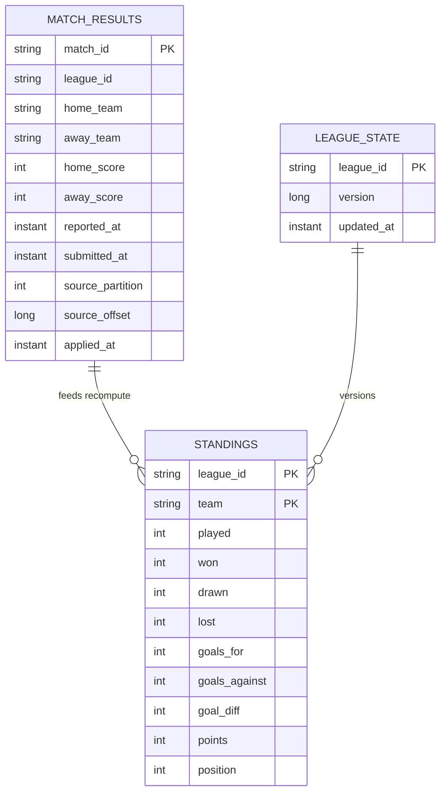

# Architecture — HLD & LLD (In-process SSE)

> Default on `main`: SSE after apply is in-process. No `standings-updated` Kafka fan-out. Compare with `variant/kafka-sse-fanout`.


How Live Standings is built: the shape of the system (HLD), then the concrete APIs, Kafka path, data model, and classes (LLD).

| Doc | Use it for |
|-----|------------|
| [README.md](./README.md) | Run the stack, try a result, fire the burst |
| [DECISIONS.md](./DECISIONS.md) | Why D1–D4, SSE, and auth — costs and rejected alternatives |
| **This file** | What the pieces are and how a result becomes a live table |

Package: `com.phinixlabs.livestandings`.

---

# Part 1 — High-level design

## The problem

Organisers submit and correct match results from phones. Captains watch one shared table. On a busy Sunday that means ~200 matches in ~90 minutes, clumps of 20–30, and ~10–15% corrections.

Two things must hold:

1. **Correct** — captains never rank on an overwritten score  
2. **Observable** — Grafana shows real ingest lag, not a frozen client number  

## Fixed stack

| Layer | Technology |
|-------|------------|
| API / apply / SSE | Spring Boot 4.1 · Java 21 |
| Messaging | Kafka (KRaft), 3 partitions |
| Persistence | MySQL 8 |
| UI | React (Vite), nginx in compose |
| Observability | Actuator → Prometheus → Grafana |
| Bring-up | `docker compose up --build` |

## Actors

| Actor | Writes results? | Reads |
|-------|-----------------|-------|
| Organiser | Yes (`X-Organiser-Token`) | — |
| Captain | No | Public GET + SSE |
| Reviewer / loadgen | Yes (token) | REST + Grafana |

## Core invariant

**Submit and correct never write standings.** Only the Kafka apply path does.

```text
REST  →  Kafka (match-results)  →  consumer apply  →  MySQL
                                                      ↓
                                          SSE hub (same JVM)  →  captain UI
```

## System context



## Logical components

| Component | Responsibility |
|-----------|----------------|
| Results API | Validate + publish `ResultEvent` → **202 Accepted** |
| Results consumer | Batch consume → offset-guarded upsert → recompute → ack |
| Standings API | Full snapshot |
| SSE hub | Per-instance emitters; snapshot on connect |
| SSE hub | In-process push after apply (this JVM only) |
| LagProbe | AdminClient gauge: log-end − committed |
| React board | `EventSource`; ignore older `version` |
| Loadgen | Sunday burst: 200 / clump 30 / ~12% corrections |

## Deployment (Compose)

| Service | Port | Role |
|---------|------|------|
| `web` | 3000 → 80 | React + nginx `/api` proxy (SSE-safe) |
| `server` | 8080 | Spring Boot |
| `mysql` | 3307 → 3306 | Persistence |
| `kafka` | 9092 / 29092 | Broker (compose / host) |
| `prometheus` | 9090 | Scrape |
| `grafana` | 3001 → 3000 | Ingest dashboard (anon viewer) |

## Non-functional map

| Concern | Approach | Decision |
|---------|----------|----------|
| Ordering per league | Kafka key = `leagueId` | [D2](./DECISIONS.md#d2--kafka-ordering) |
| Correction authority | Partition offset, not `reported_at` | [D1](./DECISIONS.md#d1--corrections) |
| Correctness under replay | Full league recompute | [D3](./DECISIONS.md#d3--recompute-not-incremental) |
| Live UX | SSE in-process after apply | [Real-time](./DECISIONS.md#real-time-delivery) |
| Observability | LagProbe + apply latency + rates | [D4](./DECISIONS.md#d4--metrics) |
| Auth | Token on writes only | [Auth](./DECISIONS.md#auth) |
| Scale | Must not *accidentally* require one process; one process is fine | — |

## Out of scope

Signup / OAuth · styling polish · multi-sport rules · match history / charts · required horizontal scale.

---

# Part 2 — Low-level design

## Package layout

```text
com.phinixlabs.livestandings
├── controller/     ResultsController, StandingsController
├── service/        ports + impl/ + StandingsCalculator
├── kafka/          producers, consumers, events
├── sse/            StandingsSseHub
├── entity/         MatchResult, Standing, LeagueState
├── repository/     Spring Data JPA
├── dto/            API request / response
├── records/        MatchScore, TeamStanding
├── config/         Kafka, WebMvc + auth interceptor
├── metrics/        LagProbe, IngestMetrics
└── common/         ApiResponse, exceptions, advice
```

## API surface

| Method | Path | Auth | Behaviour |
|--------|------|------|-----------|
| `POST` | `/api/leagues/{leagueId}/results` | Organiser | Publish submit `ResultEvent` → **202** |
| `PUT` | `/api/leagues/{leagueId}/results/{matchId}` | Organiser | Publish correction `ResultEvent` → **202** |
| `GET` | `/api/leagues/{leagueId}/standings` | Public | Full snapshot + `version` |
| `GET` | `/api/leagues/{leagueId}/standings/stream` | Public | SSE: snapshot, then live pushes |
| `GET` | `/actuator/prometheus` | — | Metrics scrape |

Envelope: `ApiResponse<T>` / `ErrorResponse` via `GlobalExceptionHandler`.  
Auth: `OrganiserAuthInterceptor` on write paths — header `X-Organiser-Token` vs `ORGANISER_TOKEN`.

## End-to-end sequence

Submit → Kafka → apply → SSE (same JVM) → UI:



## Kafka design

| Topic | Key | Partitions | Producers | Consumers |
|-------|-----|------------|-----------|-----------|
| `match-results` | `leagueId` | 3 | `ResultsProducer` | `ResultsConsumer` — **shared** group `livestandings-results-applier`, **batch**, manual ack |

Producer (application.yaml): `acks=all`, idempotent, `max.in.flight ≤ 5`.  
Serde: `JacksonJsonSerializer` / `JacksonJsonDeserializer` (Spring Kafka 4 / Jackson 3).  
Factory: `resultsKafkaListenerContainerFactory` (batch).

**Event**

```text
ResultEvent(matchId, leagueId, homeTeam, awayTeam, homeScore, awayScore,
            reportedAt, submittedAt, correction)
```

## Apply path (D1 + D3)

Class: `MatchResultApplyServiceImpl.applyBatch` — one `@Transactional`.

```text
group batch by leagueId
for each league (sorted by offset):
  tryUpsert each ConsumedResult(event, partition, offset)
    - new matchId → insert + store partition/offset
    - existing:
        - league mismatch → reject (metric)
        - offset <= stored OR wrong partition → reject stale/duplicate (metric)
        - else update scores + metadata
  if any accepted for league:
    recomputeStandings(leagueId)   # all MatchScore → StandingsCalculator
    delete + insert standings rows
    bump league_state.version
    record apply latency (submittedAt → now)
return LeagueUpdate list → caller pushes SSE in-process → ack
```

**Ranking** (`StandingsCalculator`): points → goal difference → goals for → team name.  
Points: win 3, draw 1, loss 0.

Full recompute avoids silent drift if a message is applied twice or out of order; O(matches) is fine at ~200. See [D3](./DECISIONS.md#d3--recompute-not-incremental).

## Data model



## Real-time (SSE)

1. Captain opens `EventSource(/api/leagues/{id}/standings/stream)`.
2. nginx proxies with `proxy_buffering off` (compose). Vite proxies in local dev.
3. Server: `SseEmitter(0L)` registered in `StandingsSseHub`; immediate snapshot event `standings`.
4. After apply: `ResultsConsumer` → `getSnapshot` → `StandingsSseHub.sendSnapshot` (same JVM).
5. React keeps `versionRef`; **ignores** payloads with `version < current`.

## Auth

`WebMvcConfig` registers `OrganiserAuthInterceptor` on organiser write mappings only.  
Missing / wrong token → `ForbiddenException` → **403**. No Spring Security filter chain.

## Metrics

| Metric | Type | Meaning |
|--------|------|---------|
| `standings_ingest_lag` | Gauge | Σ (log-end − committed) on `match-results` applier group; polled ~every 5s via AdminClient |
| `standings_apply_latency` | Timer | `submittedAt` → apply commit (tagged by league) |
| `standings_results_applied` | Counter | Accepted upserts |
| `standings_stale_or_duplicate_rejections` | Counter | Offset / league rejects |

Grafana dashboard UID `livestandings-ingest` (provisioned).  
Prometheus scrapes `server:8080` and optionally `host.docker.internal:8080`.

## Frontend

- Single page: `web/src/App.jsx`
- State: league id, snapshot, status, version ref
- Transport: `EventSource` for the live table (full snapshot on connect and after each apply)
- Flash UI when version bumps

## Load generation

| Script | Command |
|--------|---------|
| Python | `python3 loadgen/load_burst.py` |
| Java | `java loadgen/LoadBurst.java` |

Behaviour: **200** matches, clumps of **30** (parallel within clump), pause between clumps, then **~12%** corrections (same match id, new scores) — all via REST → Kafka.

## Failure / delivery semantics

| Failure | Behaviour |
|---------|-----------|
| Crash after DB commit, before Kafka ack | Redelivery; D1 rejects same / older offset |
| Crash before DB commit | No ack → retry apply |
| Stale correction (older offset) | Rejected; metric incremented |
| SSE client disconnect | Emitter removed; apply unaffected |
| nginx buffers SSE | Mitigated by `proxy_buffering off` |

At-least-once consume + idempotent offset guard ≈ effective exactly-once **standings effect** for a given offset.

## Key classes

| Class | Role |
|-------|------|
| `ResultsController` / `ResultsServiceImpl` | Write path → Kafka only |
| `ResultsProducer` / `ResultsConsumer` | `match-results` I/O |
| `MatchResultApplyServiceImpl` | D1 / D3 transaction |
| `StandingsCalculator` | Pure ranking |
| `StandingsController` / `StandingsServiceImpl` | Reads |
| `StandingsSseHub` | Emitter registry |
| `LagProbe` / `IngestMetrics` | D4 |
| `OrganiserAuthInterceptor` | Write auth |

---

# Part 3 — Decision map

| ID | Choice | Detail |
|----|--------|--------|
| D1 | Offset authority for corrections | [DECISIONS.md](./DECISIONS.md#d1--corrections) |
| D2 | Keyed Kafka + manual ack after commit | [DECISIONS.md](./DECISIONS.md#d2--kafka-ordering) |
| D3 | Full recompute per league per batch | [DECISIONS.md](./DECISIONS.md#d3--recompute-not-incremental) |
| D4 | AdminClient lag + apply latency | [DECISIONS.md](./DECISIONS.md#d4--metrics) |
| RT | SSE in-process after apply | [DECISIONS.md](./DECISIONS.md#real-time-delivery) |

---

# Part 4 — Reviewer walkthrough

1. `docker compose up --build`
2. Open the board → http://localhost:3000  
   Open Grafana ingest → http://localhost:3001/d/livestandings-ingest/live-standings-ingest?orgId=1&refresh=5s
3. `python3 loadgen/load_burst.py` (or `java loadgen/LoadBurst.java`)
4. Confirm: standings update live · corrections win · Grafana shows apply rate / lag honestly
