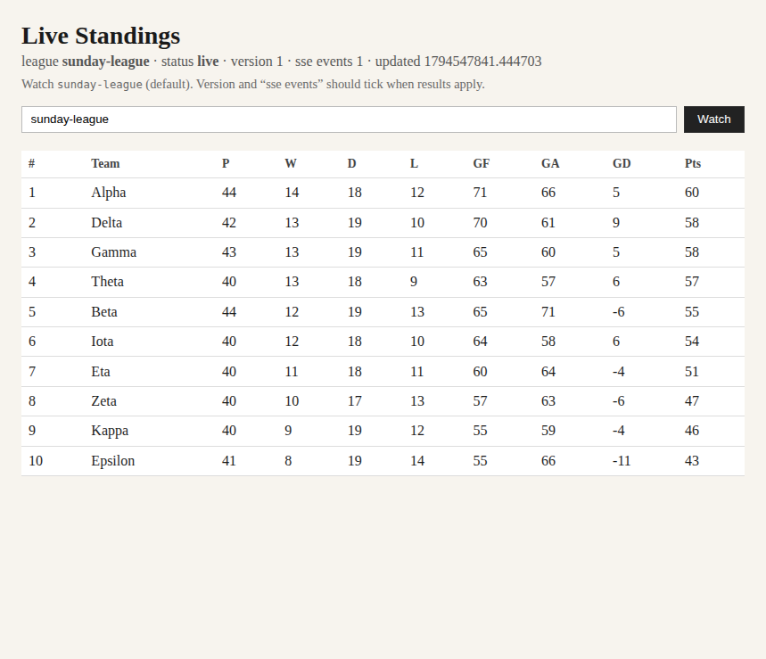
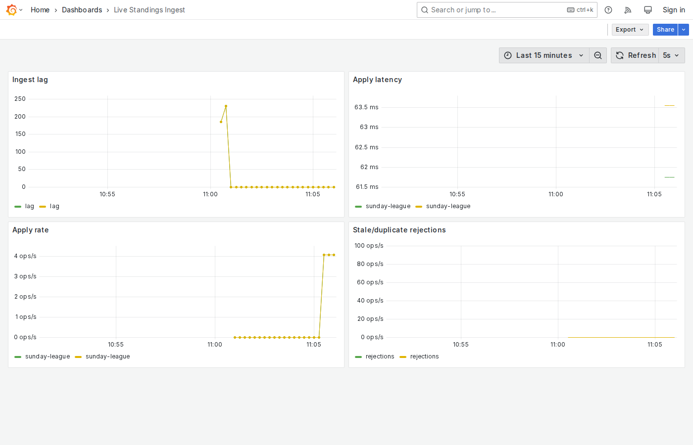
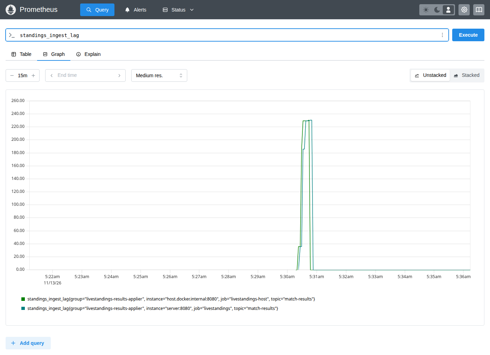
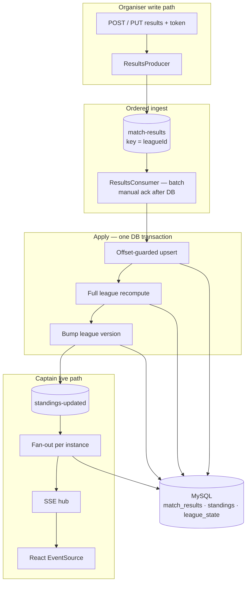

# Live Standings — Kafka SSE fan-out

**Branch `variant/kafka-sse-fanout`.** Multi-instance design: after Kafka apply, publish `standings-updated` and each app instance fans out SSE to its captains. See `main` for the simpler in-process SSE floor.

## About

Sunday league. Games finish in waves. Someone on the sideline taps a score into a phone — then taps again when they mistyped. Across town, every captain has the same table open and expects it to move the moment a result lands, never on a score that was already corrected.

That is what this project is: a **live standings board** for one amateur league. Not a fantasy UI mock — a full path from phone submit to ranked table, with proof that ingest is keeping up.

**What “busy” looks like**

| | |
|--|--|
| Matches | ~200 in about 90 minutes |
| How they arrive | Clumps of 20–30 in a few seconds |
| Corrections | ~10–15% (same match, new score) |

**Who does what**

| Who | Role |
|-----|------|
| Organiser | Submits and corrects results (token-protected writes) |
| Captain | Watches the board live — public read + SSE, cannot write |

**How a result travels**

```text
Organiser phone  →  REST  →  Kafka  →  MySQL standings  →  SSE  →  Captain browser
                                      ↑
                                 Grafana (ingest lag)
```

The submit API never writes standings. Kafka apply does. Captains get a snapshot on connect, then live pushes; the UI ignores older `version`s so a correction cannot flash the wrong ranking.

**Stack:** Spring Boot · Java 21 · Kafka · MySQL · React · Prometheus · Grafana — brought up with one Compose command.

---

## Get started

### 1. Start everything

From the repo root:

```bash
docker compose up --build
```

That one command starts **six** services together: React (nginx), Spring Boot, Kafka, MySQL, Prometheus, and Grafana.

Wait until Kafka and MySQL are healthy and the API answers:

```bash
curl -s http://localhost:8080/actuator/health
```

You want `"status":"UP"`.

### 2. Open the apps

| What | Open |
|------|------|
| Live standings board | http://localhost:3000 |
| API | http://localhost:8080 |
| Grafana ingest dashboard | http://localhost:3001/d/livestandings-ingest/live-standings-ingest?orgId=1&refresh=5s |
| Prometheus | http://localhost:9090 |

Defaults:

- Organiser token: `dev-organiser-token`
- Demo league: `sunday-league`
- MySQL on host port **3307**

Grafana needs **no login** (anonymous viewer).

### 3. Try a single result

```bash
curl -X POST http://localhost:8080/api/leagues/sunday-league/results \
  -H 'Content-Type: application/json' \
  -H 'X-Organiser-Token: dev-organiser-token' \
  -d '{"matchId":"m-001","homeTeam":"Red Foxes","awayTeam":"Blue Wolves","homeScore":3,"awayScore":2}'
```

Refresh or keep the board open — within a second or two the table should move (`version` ticks, SSE event count rises).

Correct the same match:

```bash
curl -X PUT http://localhost:8080/api/leagues/sunday-league/results/m-001 \
  -H 'Content-Type: application/json' \
  -H 'X-Organiser-Token: dev-organiser-token' \
  -d '{"homeTeam":"Red Foxes","awayTeam":"Blue Wolves","homeScore":2,"awayScore":2}'
```

The ranking must reflect **2–2**, never the overwritten 3–2.

### 4. Fire the Sunday burst

With the stack still up (and ideally Grafana + the board open):

```bash
python3 loadgen/load_burst.py
# or: java loadgen/LoadBurst.java
```

This simulates the Sunday load: **200** matches, **clumps of 30**, then **~12% corrections** — all through REST → Kafka (not direct DB inserts).

### 5. Stop

```bash
docker compose down
```

---

## What it looks like

### Captain board

http://localhost:3000 — plain table, live over SSE (no full-page reload).



> **Reading this shot:** league `sunday-league`, status `live`, SSE connected. Ranking is points → goal difference → goals for → team name. When apply finishes, the server pushes a full snapshot; the UI keeps a `version` and **ignores older ones**, so captains never briefly see a ranking built from a score that was already corrected.

### Ingest health (Grafana)

http://localhost:3001/d/livestandings-ingest/… — no login required.



> **Reading this shot** (taken during `load_burst.py`):

| Panel | What it measures | What you should see under load |
|-------|------------------|--------------------------------|
| **Ingest lag** | Kafka backlog for the applier | Spike when a clump lands, then fall back to **0** as apply catches up |
| **Apply latency** | `submittedAt` → DB commit | A short rise while the league is recomputed |
| **Apply rate** | Accepted results / second | Climb during clumps, quiet afterwards |
| **Stale / duplicate rejections** | Offset or league guards | Usually **0** on a happy path (corrections are *newer* offsets, not replays) |

**Ingest lag formula** (polled ~every 5s via Kafka AdminClient):

```text
standings_ingest_lag  =  Σ  max(0,  partition log-end  −  consumer committed offset)
```

for topic `match-results` and group `livestandings-results-applier`.  
Lag ≈ 0 after a spike means **produced ≈ consumed** — the board is not falling behind. That is intentional D4 design (broker truth, not a stuck client `records-lag`).

### Same lag in Prometheus

http://localhost:9090 — query `standings_ingest_lag`.



> **Reading this shot:** flat zero → sharp spike as clumps hit Kafka → back to zero within seconds. Two overlapping series are the compose scrape (`server:8080`) and the host scrape (`host.docker.internal:8080`); both should agree. Use this to prove Grafana is wired to a **real** metric.

---

## How it works



**Invariant:** the submit endpoint never writes standings. Only the Kafka apply path does.

| Choice | Why |
|--------|-----|
| Kafka key = `leagueId` | One league stays totally ordered on one partition |
| Offset beats `reported_at` | Phone clocks / offline devices cannot reorder corrections |
| Full recompute | No silent drift if a message is applied twice |
| SSE (not WebSocket / polling) | Captains only receive; no DB thrash |
| Unique fan-out consumer group | Every app instance can push to its own browsers |

Deep dive: [ARCHITECTURE.md](./ARCHITECTURE.md) · decisions: [DECISIONS.md](./DECISIONS.md)

---

## API cheat sheet

| Action | Call |
|--------|------|
| Submit | `POST /api/leagues/{leagueId}/results` + token |
| Correct | `PUT /api/leagues/{leagueId}/results/{matchId}` + token |
| Snapshot | `GET /api/leagues/{leagueId}/standings` |
| Live stream | `GET /api/leagues/{leagueId}/standings/stream` (`text/event-stream`) |

Writes need header `X-Organiser-Token: dev-organiser-token`. Reads and SSE are public.

---

## Local Vite (optional)

If you want hot-reload UI without rebuilding the `web` image:

```bash
docker compose up -d mysql kafka
KAFKA_BOOTSTRAP_SERVERS=localhost:29092 ./mvnw spring-boot:run
cd web && npm install && npm run dev
```

Open http://localhost:5173 (Vite proxies `/api` → `:8080`).

---

## Project docs

| Doc | Purpose |
|-----|---------|
| [ARCHITECTURE.md](./ARCHITECTURE.md) | HLD + LLD |
| [DECISIONS.md](./DECISIONS.md) | D1–D4 tradeoffs, costs, rejected alternatives |
| `docs/screenshots/` | Captures used above |
